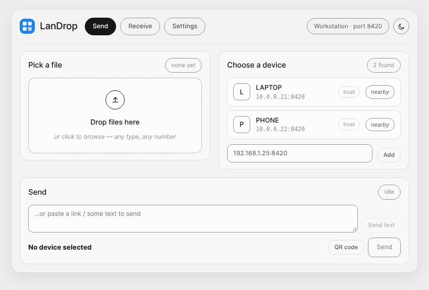
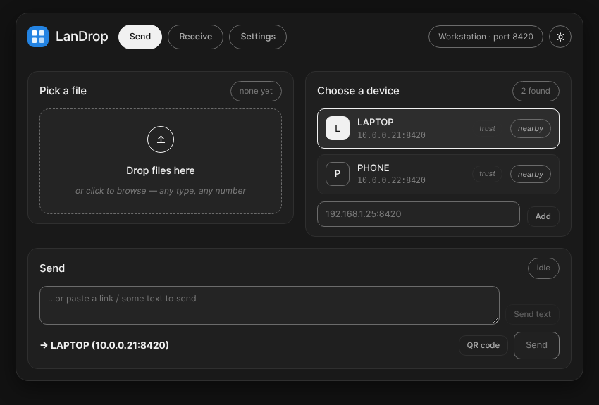
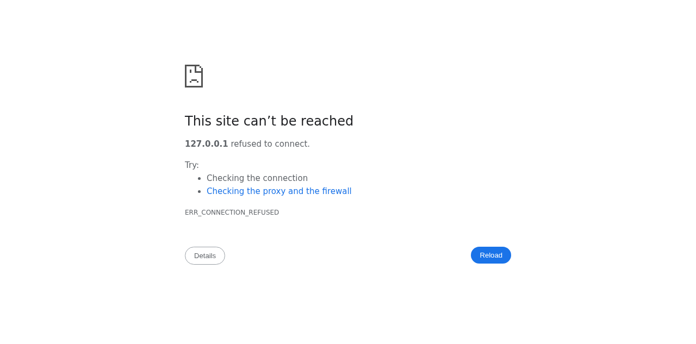
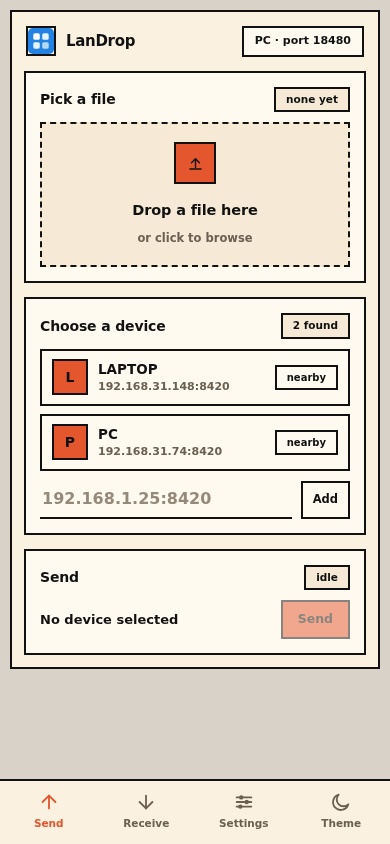
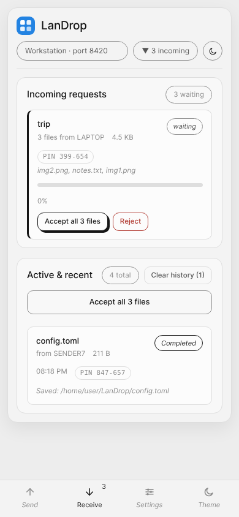

<div align="center">
  
  <h1>LanDrop</h1>
  <p>
    <a href="#license"></a>
    
    
    
  </p>
  <p><strong>Send any file to the device next to you — straight over your Wi-Fi. Nothing leaves your network.</strong></p>
  <p>
    <a href="#quick-start">Quick start</a> ·
    <a href="#features">Features</a> ·
    <a href="#screenshots">Screenshots</a> ·
    <a href="#android-app">Android</a> ·
    <a href="#documentation">Docs</a> ·
    <a href="#security-notes">Security</a> ·
    <a href="https://github.com/000jd/LanDrop">GitHub</a>
  </p>
</div>

<table>
  <tr>
    <td></td>
    <td></td>
  </tr>
  <tr><td align="center">Light</td><td align="center">Dark — same UI, one toggle</td></tr>
</table>

## Your files. Your network.

| Send | Receive | Discover |
| :--- | :--- | :--- |
| Drop a file, pick a device, hit **Send** | **Accept / reject** every incoming request | Devices find each other automatically |
| Streams straight to the other device — no size limit, no buffering | Progress with speed and time remaining, SHA-256 verified | mDNS + a UDP beacon, with manual `ip:port` peers as a fallback |

No cloud service, no accounts, no internet connection needed: files travel
peer-to-peer over plain HTTP on your own LAN, and the Rust backend plus the web
UI ship as one self-contained binary.

<details>
<summary><strong>Explore the app</strong> · Send, Receive and Settings in light and dark</summary>

<table>
  <tr>
    <td></td>
    <td></td>
  </tr>
  <tr><td align="center">Send · light</td><td align="center">Send · dark</td></tr>
  <tr>
    <td></td>
    <td></td>
  </tr>
  <tr><td align="center">Receive · light</td><td align="center">Receive · dark</td></tr>
  <tr>
    <td></td>
    <td></td>
  </tr>
  <tr><td align="center">Settings · light</td><td align="center">Settings · dark</td></tr>
</table>



On phones (browser or Android app) the tabs move to a fixed bottom nav. Same UI,
same features, same theme.
</details>

## Quick start

### One-line install (Linux & macOS)

No sudo, no build tools:

```bash
curl -fsSL https://raw.githubusercontent.com/000jd/LanDrop/main/install/install.sh | bash
```

The installer detects your OS and CPU, downloads the matching `v0.1.0` asset and
`SHA256SUMS.txt`, verifies the SHA-256 checksum, and installs
`~/.local/bin/landrop`. In a graphical session it also installs the desktop app
(force it with `--desktop`); if a prebuilt binary is not available yet and
`cargo` is installed, it falls back to `cargo install --git … --locked`.

Uninstall:

```bash
curl -fsSL https://raw.githubusercontent.com/000jd/LanDrop/main/install/install.sh | bash -s -- --uninstall
```

If `~/.local/bin` is not on your `PATH`, the installer prints the exact `export
PATH=…` line to add.

### Direct downloads (v0.1.0)

| Platform | Download | Notes |
|---|---|---|
| Linux x86_64 | [`LanDrop-v0.1.0-linux-x86_64`](https://github.com/000jd/LanDrop/releases/download/v0.1.0/LanDrop-v0.1.0-linux-x86_64) | standalone CLI + browser UI |
| Linux x86_64 | [`LanDrop-v0.1.0-linux-x86_64-desktop`](https://github.com/000jd/LanDrop/releases/download/v0.1.0/LanDrop-v0.1.0-linux-x86_64-desktop) | Tauri desktop app (window + tray) |
| Debian / Ubuntu | [`LanDrop-v0.1.0-linux-amd64.deb`](https://github.com/000jd/LanDrop/releases/download/v0.1.0/LanDrop-v0.1.0-linux-amd64.deb) | `sudo dpkg -i …` |
| Fedora / RHEL | [`LanDrop-v0.1.0-linux-x86_64.rpm`](https://github.com/000jd/LanDrop/releases/download/v0.1.0/LanDrop-v0.1.0-linux-x86_64.rpm) | `sudo rpm -i …` |
| Linux | [`LanDrop-v0.1.0-linux-x86_64.AppImage`](https://github.com/000jd/LanDrop/releases/download/v0.1.0/LanDrop-v0.1.0-linux-x86_64.AppImage) | `chmod +x … && ./…` |
| macOS arm64 | [`LanDrop-v0.1.0-macos-arm64`](https://github.com/000jd/LanDrop/releases/download/v0.1.0/LanDrop-v0.1.0-macos-arm64) | Apple silicon |
| macOS x86_64 | [`LanDrop-v0.1.0-macos-x86_64`](https://github.com/000jd/LanDrop/releases/download/v0.1.0/LanDrop-v0.1.0-macos-x86_64) | Intel |
| Windows x86_64 | [`LanDrop-v0.1.0-windows-x86_64.exe`](https://github.com/000jd/LanDrop/releases/download/v0.1.0/LanDrop-v0.1.0-windows-x86_64.exe) | browser mode |
| Android arm64 | [`LanDrop-v0.1.0-android-arm64.apk`](https://github.com/000jd/LanDrop/releases/download/v0.1.0/LanDrop-v0.1.0-android-arm64.apk) | signed APK, sideload |
| All assets | [`SHA256SUMS.txt`](https://github.com/000jd/LanDrop/releases/download/v0.1.0/SHA256SUMS.txt) | verify with `sha256sum -c` / `shasum -a 256 -c` |

### Build from source (browser mode)

```bash
make build                    # -> bin/landrop (release)
./bin/landrop                 # UI at http://localhost:8420
./bin/landrop --open          # ...and open the browser automatically
./bin/landrop -p 9000         # custom port
./bin/landrop -n living-room  # friendly device name
./bin/landrop --log-file /tmp/landrop.log   # append logs to a file (daemon use)
```

### Desktop app (Tauri v2)

```bash
make desktop-dev     # run in dev mode (cargo tauri dev)
make desktop-build   # release bundles -> target/release/bundle/ (deb / rpm / AppImage)
```

Requires the Tauri Linux dependencies (see [docs/DESKTOP.md](docs/DESKTOP.md)).
The app starts the backend inside the process, opens a native window pointing at
the local UI, and adds a tray icon (Open / Downloads / Quit); quitting shuts the
backend down gracefully.

Or install it for your user, without sudo:

```bash
make install-desktop    # ~/.local/bin/landrop + app-menu entry + icon
make uninstall-desktop  # remove it again
```

### Android

```bash
make mobile-build-phone  # APK for real phones (aarch64)
make mobile-sign         # sign with the local debug keystore
make mobile-install      # adb install, with USB debugging enabled
```

### Use it from a phone browser

Open `http://<your-ip>:8420` on any device on the same Wi-Fi — your addresses are
listed in **Settings**, with a **Copy LAN URL** button. The receiving side needs
no install at all.

## Documentation

| Need | Start here |
|---|---|
| Install & build | [One-line installer](#one-line-install-linux--macos) · [Quick start](#quick-start) · [Build](#build) · [Windows](#windows-build-browser-mode) |
| Android | [Android app](#android-app) · [Updating an installed copy](#updating-an-installed-copy) |
| Sending & receiving | [Features](#features) · [Run on two real machines](#run-on-two-real-machines) |
| Troubleshooting | [Firewall](#firewall) · [mDNS troubleshooting](#mdns-troubleshooting) · [Known limitations](#known-limitations) |
| Security & privacy | [Security notes](#security-notes) · [Configuration](#configuration) · [Security tests](docs/security-tests.md) |
| Development | [Project layout](#project-layout) · [API](#api-local) · [Wire protocol](#wire-protocol-device--device) · [Instance model](docs/INSTANCE_MODEL.md) |

## Features

- Device discovery (**mDNS/DNS-SD** `_landrop._tcp` plus a UDP beacon) with 60 s
  peer expiry, and persistent manual peers when multicast is blocked
- Accept / reject incoming transfers, with an auto-accept option
- Pick the download folder with a built-in folder browser (no typing paths);
  optional "ask where to save" mode chooses a folder per incoming transfer, with
  a "use default folder" escape hatch
- Live speed and time-remaining estimates while sending or receiving (e.g.
  `31% · 919 KB/s · ~31s left`), a receive-progress notification with a progress
  bar, and an always-visible activity strip so the Receive tab stays optional
- **Multiple files at once**: pick or drop any number of files (mixed types and
  sizes) and they are queued one after another, each with its own progress, speed
  and time remaining. On the receiving side a batch shows one **Accept all N
  files** button (that path uses the configured download folder, so the per-file
  "ask where to save" prompt is skipped).
- **Folders**: dropping a folder queues every file inside it and sends the
  relative path with each one, so the receiver recreates the tree under its
  download folder. Path segments are sanitized on arrival — `..`, absolute paths
  and drive letters are refused, so a sender cannot write outside that folder.
- **Several devices at once**: click devices to add them to the selection (the
  header shows "2 devices") and every queued file goes to each of them — one
  device works exactly as before, and a partial failure names the device it
  failed for.
- **Text and links**: paste a URL or snippet and send it like a file. The
  receiver sees it as a normal offer, can read, copy or open it in the app, and
  nothing is written to disk.
- **QR onboarding and browser download links**: `GET /api/qr` renders the node's
  LAN URL (or a live share link) as an inline SVG, and `POST /api/share-link`
  stages a file behind a 15-minute `/d/{token}` URL that any browser on the
  network can open — no LanDrop install required on the phone.
- **Resumable uploads**: a dropped connection keeps the partial file on the
  receiver. The sender asks `HEAD /api/v1/upload/{id}` for the current offset and
  resumes with `X-LanDrop-Offset`; the SHA-256 still covers the whole file.
- **Verification PIN + trusted devices**: every transfer/batch shows a
  `NNN-NNN` PIN derived from sender, receiver and batch/file, so both people can
  confirm they are looking at the same transfer. Mark a device as trusted (or
  enable "auto-accept from trusted devices only") to skip the prompt for it.
- Any file type; streaming transfer (no full-file buffering)
- SHA-256 integrity check; the declared size is enforced while streaming;
  collision-safe filenames (`file.txt`, `file-1.txt`, …)
- One-time upload token per transfer — valid while the transfer is accepted or
  streaming, then burned on completion, cancellation or rejection. No accounts,
  no login, no shared secret required: the app is open on your LAN by design
- Live UI updates over Server-Sent Events (SSE), including throttled progress;
  polling only as a fallback while SSE is unavailable
- **Quiet monochrome UI** (soft grey surfaces, hairline borders, pill chips whose
  selected state is solid ink, small italic labels, rounded corners, one hard
  offset shadow on primary actions, folder-drop zone, bottom nav on phones) with a
  matching **dark mode** — toggle in the top bar, remembered per browser, light by
  default
- Desktop notifications for incoming requests, and a progress-bar notification
  while receiving (`notify-send` / notification daemon)
- **Android share sheet**: share files or text from any app straight into LanDrop
  (`ACTION_SEND` / `ACTION_SEND_MULTIPLE`), and a Wi-Fi `MulticastLock` keeps
  mDNS discovery receiving while the app is visible
- Persistent settings (name, port, download dir, trusted devices) in
  `~/.config/landrop/config.toml`; CLI flags apply to a single run only
- Private, auto-cleaned staging for outgoing files (no leftover copies)
- Tauri desktop wrapper with tray icon, **single instance** (a second launch
  raises the window that is already open; a newer build retires an idle older
  copy instead of piling up windows) and graceful shutdown
- Every build reports its **build time** in `GET /api/info` and in
  **Settings → This device → Version**, so a stale install is obvious

## Platform support

| Platform | Support |
|---|---|
| Linux | Desktop app (`.deb` / `.rpm` / `.AppImage`) and browser mode |
| Windows | Browser mode (`cargo build --release`) |
| macOS | Browser mode |
| Android | Signed APK with the same UI and features (aarch64), system share sheet, no runtime permissions |

## Build

Requires Rust **1.86+** — measured, not guessed: the locked dependencies need it
(`icu_*`/`idna_adapter` via `url`). The hand-written code itself compiles on much
older toolchains. Verified with 1.92 and 1.86 locally and by the `msrv` job in CI.
The browser-mode binary needs no system dependencies beyond a C toolchain — the UI
is embedded, so there is no Node step.

```bash
make build          # -> bin/landrop (release)
make run            # build + run with the UI
make test           # unit + end-to-end tests
make fmt            # cargo fmt
make vet            # cargo clippy -- -D warnings
make icons          # regenerate icon assets (python3 + Pillow)
make clean
```

Or directly: `cargo run --release` / `cargo build --release`. The result is a
single self-contained file at `target/release/landrop` (`bin/landrop` via
`make build`).

### Windows build (browser mode)

```bash
cargo build --release
# run: .\target\release\landrop.exe
# config: %APPDATA%\landrop\config.toml
```

## Run on two real machines

1. Install/run LanDrop on both machines (same version recommended).
2. They should appear in each other's device list within seconds — mDNS
   (`_landrop._tcp`) plus a UDP beacon on port 8420 re-sent every 2 s, so no
   manual setup is needed on a normal home/office network. If a device is
   missing, check the [firewall](#firewall) notes and [mDNS
   troubleshooting](#mdns-troubleshooting) (client isolation blocks
   multicast/broadcast).
3. Pick a file, pick the device, **Send**, then **Accept** on the other side.
4. The file is saved in the download folder (default `~/Downloads/LanDrop`).

If discovery fails, add a manual peer with the other machine's `ip:port`, e.g.
`192.168.1.25:8420`. Find your IP with `ip addr` (Linux), `ipconfig` (Windows) or
`ifconfig` (macOS).

## Android app

The same app — same UI, same features — builds for Android from the same crate
(`desktop/`, the Tauri app). Tauri v2 mobile loads it as a library, so the app
logic lives in `desktop/src/lib.rs` and `main.rs` is a thin desktop shim.

```bash
make mobile-targets        # one-time: add the Rust android targets
make mobile-init           # one-time: generate desktop/gen/android (committed)
make mobile-build          # APK for the emulator (x86_64)
make mobile-build-phone    # APK for real phones (aarch64)
make mobile-sign           # sign it locally (debug keystore, for testing)
make mobile-install        # adb install on a connected device/emulator
make mobile-dev            # run with live reload
```

Requirements: Android SDK + platform-tools + NDK (`ANDROID_HOME`, NDK ≥ 28),
JDK 17, and `cargo install tauri-cli --version '^2'`.

Installing on a phone: `make mobile-build-phone`, `make mobile-sign`, then copy
`bin/LanDrop-android-arm64.apk` to the phone and tap it (enable "install unknown
apps" for your file manager), or `make mobile-install` with USB debugging on.
The signing target uses a local **debug** keystore, which is fine for
sideloading; a published release would use your own release keystore
(`key.properties`).

Copying the APK by hand has one trap: phones keep every file with the same name
(`LanDrop-android-arm64(1).apk`, `…(2).apk`, …), so it is easy to tap an old copy
and conclude "the UI did not update". Names produced by the release script are
timestamped (`LanDrop-arm64-2026-10-15-2043.apk`) to avoid this — and after
installing, **Settings → This device → Version** shows the build time, so you can
tell instantly which copy is running.

What works: discovery (UDP beacon + mDNS), sending, accepting/rejecting, text
snippets, QR codes and browser share links, resumable uploads, verification PINs
and trusted peers, the folder picker, speed/ETA, SSE live updates, settings and
progress in the UI. The backend runs inside the app process and the webview talks
to it on `127.0.0.1` (cleartext is allowed for localhost only, via
`desktop/gen/android/.../network_security_config.xml`).

The system **share sheet** is wired in: sending files or text from another app
to LanDrop copies the streams into the app's private `cacheDir/shared` folder
(using the source's display name) and posts the paths/text to the local
`/api/ui/shared-inbox` queue. The UI drains that queue and treats the files like
a normal selection; text lands in the snippet box.

Mobile behaviour to know about:

- Received files land in the app's own folder on shared storage:
  `Android/data/dev.landrop.app/files/Download`. No runtime permissions needed,
  reachable over USB and by file managers; the in-app folder picker starts there
  (scoped storage hides most of the rest of the device, so a system-wide folder
  picker would need Android's SAF, which is a follow-up).
- A Wi-Fi `MulticastLock` is acquired in `onResume()` and released in
  `onPause()`, so mDNS discovery keeps receiving on networks that filter
  multicast while the app is visible.
- No tray and no system-dialog prompt: the in-app UI shows incoming requests, and
  the activity strip keeps the progress visible from any tab.
- Keep the app open while transferring — Android may suspend background apps. A
  foreground service (background receiving) is on the roadmap.

## Updating an installed copy

The UI is compiled **into** the binary, so a new build only shows up once the old
process is gone. Two things make that visible instead of confusing:

- Every build carries a **build marker** (the build time), reported by
  `/api/info` and shown in **Settings → This device → Version** as e.g.
  `0.1.0 · 15 Oct, 20:34`. If that timestamp is older than your last build, you
  are still looking at the old copy.
- The app refuses to attach to a node built from **different** sources. Launching
  a fresh build while an older copy is still running used to be swallowed by
  Tauri's single-instance plugin (the new launch silently re-focused the old
  window — this is why a new `.deb` could look like it "did nothing"). There is
  no such plugin now, and **only one instance ever runs**: a second launch raises
  the window that is already open, and a newer build *retires* an idle older copy
  through its local-only `POST /api/quit` before taking over the port. If the
  older copy is busy transferring something, it is left alone and you get a
  notification asking you to quit it from its tray menu. See
  [docs/INSTANCE_MODEL.md](docs/INSTANCE_MODEL.md).

1. **Quit the running app** (tray → **Quit**, or `pkill -f landrop-desktop`; on
   Windows: Task Manager → end `landrop-desktop.exe`). Do this *before*
   reinstalling so the old UI cannot linger anywhere.
2. Rebuild and reinstall:
   - browser mode: `make build` (and `make install-desktop` if installed that way)
   - desktop app: `make desktop-build`, then install the fresh package from
     `target/release/bundle/` (deb/rpm/AppImage)
   - Android: `make mobile-build-phone && make mobile-sign`, then install
     `bin/LanDrop-android-arm64.apk` (`make mobile-install` with a USB cable is
     the most reliable — updating over the running app always kills the old
     process)
3. Reload any open browser tab. UI files are served with `Cache-Control:
   no-cache`, so a normal refresh picks up the new assets.
4. Check **Settings → Version** to confirm the build time matches the one you
   just built.

## Security notes

- **LAN only**: the API binds to `0.0.0.0` so devices on your network can reach
  it. Anyone on the same network who knows your port can offer files (they still
  need your **Accept** click) and can open the local UI. This is intentional:
  LanDrop is a no-account, no-login tool for trusted networks.
- **Settings and trust are machine-local**: changing the device name, port,
  download folder, auto-accept, trusted devices or autostart is only accepted
  from the machine running LanDrop. A phone on the LAN can send, accept and
  reject, but cannot rewrite settings or mark itself trusted.
- **Browser-safe**: cross-origin requests are rejected and `Host` headers must be
  a plain IP/localhost, so a website you happen to visit cannot drive the local
  API (CSRF / DNS rebinding). The bundled UI ships a strict CSP.
- Filenames are sanitized (no path traversal, control characters and bidi
  overrides stripped, length capped), files never overwrite each other, the
  declared size is enforced while streaming, and SHA-256 is verified when the
  sender provides it.
- Target addresses are checked: unspecified, multicast, broadcast (including the
  `x.y.z.255` subnet form) and link-local addresses are refused, and loopback is
  only accepted for requests that come from this machine — a device on the LAN
  cannot point the app at itself or at another local service.
- Save folders may not be system directories (`/etc`, `/usr`, `/boot`, `/var`, …);
  home folders, removable media and temp folders stay allowed.
- The desktop helpers `POST /api/quit` (retire an older copy),
  `POST /api/window/focus` (raise the running window),
  `POST /api/peers/trust`, `POST /api/transfers/clear` and the Android
  `/api/ui/shared-inbox` queue are **local-only** and answer `403` to anything
  that does not come from this machine.
- Every rule above has a test; [docs/security-tests.md](docs/security-tests.md)
  maps them, including the transcripts they came from.
- Outgoing files are staged in a private `outbox` directory under the config dir
  (mode 0700) and deleted once the transfer ends; uploads never buffer a whole
  file in memory.
- Each accepted transfer uses a one-time upload token. It stays valid while the
  transfer is accepted or streaming so a resume can verify itself, and is burned
  on completion, cancellation, rejection, oversized bodies and checksum
  failures; no persistent credentials are stored. A resume offset must match the
  on-disk partial file exactly (`409` otherwise). Link-local, multicast and
  unspecified targets are refused, so the app can't be aimed at metadata
  endpoints or broadcast addresses.
- The verification PIN is a human check, not an authentication factor: it stops
  someone from talking you into the wrong transfer, but possession of the upload
  token remains the actual authorization. Trusted peers are an explicit,
  machine-local convenience and never override the shared-token setting.
- JSON request bodies are capped at 64 KiB; only the file-upload routes stream
  unbounded data, with free-space guards on both sides. Four uploads stream at a
  time per sender, so a large selection cannot open an unbounded number of
  parallel connections.

## Configuration

| Location (Linux) | `~/.config/landrop/config.toml` |
| Location (Windows) | `%APPDATA%\landrop\config.toml` |

```toml
id = "6c1f…"            # auto-generated, stable
name = "laptop"
port = 8420
downloads = "/home/me/Downloads/LanDrop"
auto_accept = false
auto_accept_trusted_only = false
trusted_peers = []      # device ids that may skip the accept prompt
ask_save_path = false   # ask for a folder when accepting each incoming file
manual_peers = ["192.168.1.25:8420"]
```

> Older configs may contain a `token` key; it is still parsed (for backward
> compatibility) but no longer surfaced in the UI or docs.
>
> `--port`, `--downloads` and `--name` apply to that run only and are **not**
> written to the config file (only the generated identity, an explicitly
> configured `port = 0`, settings saved in the UI, and manual peers are
> persisted). `LANDROP_CONFIG_DIR` is still honored when set before launch, also
> by the desktop app — handy for smoke tests in a throwaway config dir
> (`LANDROP_CONFIG_DIR=/tmp/ld ./landrop-desktop`).

## Screenshots

The same quiet theme runs in the browser, the desktop app and the Android app,
light and dark:

<table>
  <tr>
    <td></td>
    <td></td>
  </tr>
  <tr><td align="center">Send · light</td><td align="center">Send · dark</td></tr>
  <tr>
    <td></td>
    <td></td>
  </tr>
  <tr><td align="center">Receive · light</td><td align="center">Receive · dark</td></tr>
  <tr>
    <td></td>
    <td></td>
  </tr>
  <tr><td align="center">Settings · light</td><td align="center">Settings · dark</td></tr>
  <tr>
    <td></td>
    <td></td>
  </tr>
  <tr><td align="center">Phone · send</td><td align="center">Phone · receive</td></tr>
</table>

<details>
<summary><strong>More</strong> · two instances on one machine, firewall, mDNS, project layout, API</summary>

### Run two instances on one machine (test / dev)

```bash
./scripts/run_two_local.sh
```

This builds the app and starts two instances with fully isolated state (temp
config + download dirs, removed when the script exits):

- **A** on port `8420`
- **B** on port `8421`

The script waits until both are serving and registers each instance as the
other's manual peer (mDNS on loopback is unreliable), so you can go straight to:

1. Open http://localhost:8420 (A), pick a file, select the peer, click **Send**
2. Open http://localhost:8421 (B), click **Accept** — the file lands in B's
   download folder

Both run with `--no-port-scan`, so a busy port fails loudly instead of silently
moving to another one.

### Firewall

- **TCP 8420** — the app's listening port (default; change in Settings)
- **UDP 5353** — mDNS discovery (only needed for automatic discovery)

On Linux with firewalld/ufw, allow both. Example (ufw):

```bash
sudo ufw allow 8420/tcp
sudo ufw allow 5353/udp
```

Two traps worth knowing:

- **Rules bound to a path.** Some firewall front-ends create rules for an
  *application path* instead of a port. After reinstalling LanDrop to a new
  location (`~/.local/bin/landrop` → `/usr/bin/landrop-desktop`, or a different
  AppImage), that rule no longer matches and the device becomes silently
  unreachable. Re-add the rule for the new path, or prefer plain port rules
  (`sudo ufw allow 8420/tcp`, `sudo firewall-cmd --add-port=8420/tcp`).
- **One-way blocking is visible now.** Each node probes every device it has
  discovered every 15 s. A device that announces itself but does not answer TCP
  is marked **unreachable** in the device list (hover for the hint), and the log
  says which address to check. That is the signature of a firewall on the *other*
  device — the UDP beacon still gets through, so the device appears even though
  sending to it would fail.

If the device list is empty even though both apps are running, the beacons are not
getting through: check that the two devices are on the same network (not a guest
Wi-Fi or a VPN), then the firewall rules above, then add a manual peer with the
other machine's `ip:port` to bypass discovery entirely.

### mDNS troubleshooting

- Some routers/APs block multicast between clients ("client isolation"). In that
  case use **manual peers** — the app works fine without mDNS.
- Check that UDP 5353 is allowed and that `avahi-daemon` (or similar) is not
  interfering.
- If discovery works one-way only, both devices must run the same protocol
  version (TXT `ver=1`).
- A process that dies hard (SIGKILL, power loss) cannot send its mDNS goodbye
  packet, so other devices keep listing it for up to 60 s — the peer TTL — before
  it drops out. A normal quit always announces itself.
- While the LAN looks unstable (no peers yet, or devices joining and leaving) the
  UDP beacon goes out every 2 s; once the peer list has been stable for a minute
  it backs off to every 20 s.

### Project layout

```
landrop/
  PLAN.md
  Cargo.toml            # workspace root (members: desktop)
  Makefile
  README.md
  assets/
    icon.svg            # app icon (SVG, canonical mark)
    icon.png            # 256x256 mark (launcher/app icon)
    icon-32.png/.rgba   # tray icon for the desktop wrapper
    icon-soft.png       # 128x128 mark on UI grey (header logo)
    icon-with-name.png  # full logo with name (docs)
    landrop.desktop     # Linux desktop entry
  src/
    main.rs             CLI: flags, signal handling, uses landrop::app
    app.rs              reusable startup (NodeOptions / start_node / RunningNode)
    lib.rs
    config.rs           TOML config (0600)
    protocol.rs         wire types + sanitize/unique-path/sha helpers
    peers.rs            peer store (mdns + manual, TTL expiry)
    discovery.rs        mDNS advertise + browse (_landrop._tcp)
    events.rs           SSE event bus
    instance.rs         single-instance lock + build-marker probes
    notify.rs           desktop notifications (best-effort)
    util.rs             shared helpers (detached processes, disk space)
    transfer.rs         transfer state machine + manager
    transfer/sender.rs  outgoing: offer -> poll -> stream upload
    transfer/receiver.rs incoming: temp file -> verify -> rename
    server.rs           axum router + app state
    server/handlers.rs  local API + wire protocol + SSE + UI
  desktop/
    Cargo.toml          Tauri v2 wrapper crate (landrop-desktop)
    tauri.conf.json
    src/main.rs         window, tray, build-aware instance, graceful shutdown
  ui/
    index.html          single-page UI (tabs: Send / Receive / Settings)
    theme-quiet.css     quiet monochrome theme (light + dark)
    app.js              vanilla JS, SSE + fetch, debounced renders
  tests/
    integration.rs      in-process e2e (offer/accept/reject/upload) + start_node
  scripts/
    run_two_local.sh
    generate_icons.py   # regenerate icon assets from assets/icon.svg
  demo/
    lightmode.png       # README hero, light
    darkmode.png        # README hero, dark
  docs/
    DESKTOP.md          Tauri Linux deps + Android build steps
    screenshots/        UI captures used in this README
```

### API (local)

| Endpoint | Purpose |
| --- | --- |
| `GET /api/info` | device id, name, port, download dir, version, build, LAN IPs, free/total disk space |
| `GET /api/peers` | discovered + manual peers, each with `trusted`, `reachable` |
| `POST /api/peers/manual` | add a manual peer (`{"address":"ip:port"}`) |
| `POST /api/peers/trust` | trust/untrust a device (`{"peer_id":"…","trusted":true}`, local-only) |
| `GET /api/transfers` | all transfers |
| `POST /api/transfers/clear` | drop completed/failed/cancelled/rejected history (local-only; files stay) |
| `POST /api/send` | start a send (multipart: repeat `target` for several devices, `file`, optional `rel_path`, `batch_id`, `batch_name`) |
| `POST /api/send-path` | send local files/folders by path (desktop drop; walks folders, local-only) |
| `POST /api/send-text` | send a text/link snippet (`{"text":"…","targets":["ip:port"]}`) |
| `POST /api/transfers/{id}/cancel` | cancel |
| `POST /api/transfers/{id}/accept` | accept incoming (optional `{"save_dir": "/path"}`) |
| `POST /api/transfers/{id}/reject` | reject incoming |
| `GET /api/fs/list?path=…` | browse subfolders (folder picker) |
| `POST /api/fs/mkdir` | create a folder from the picker |
| `GET /api/events` | SSE stream (`peer_updated`, `transfer_updated`, `transfers_cleared`, …) |
| `POST /api/batches/{id}/accept` · `/reject` · `/cancel` | accept, reject or cancel a whole folder/batch in one request |
| `GET /api/qr` | inline SVG QR for this node's LAN URL (optional `?share=<token>` for a share link) |
| `POST /api/share-link` | stage a file for a 15-minute browser download and return `{token,url}` (local-only) |
| `GET /d/{token}` | browser-direct download of a staged share link |
| `DELETE /api/share-link/{token}` | revoke a share link and delete its staged file (local-only) |
| `POST/GET /api/ui/shared-inbox` | queue / drain Android share-sheet paths and text (local-only) |
| `POST /api/ui/selection` | publish the devices the local UI has selected (used by desktop drops) |
| `POST /api/quit` · `POST /api/window/focus` | local-only desktop helpers (retire an older build, raise the window) |
| `GET /api/metrics` | transfers started/finished/failed and bytes sent/received |
| `GET/POST /api/settings` | read / update settings, including `trusted_peers` and `auto_accept_trusted_only` |

### Wire protocol (device ↔ device)

```
POST /api/v1/offer       {sender_id, sender_name, filename, size, sha256?, note?,
                          rel_path?, batch_id?, batch_name?, text?}
GET  /api/v1/offer/{id}  {status: pending|accepted|rejected|completed,
                          upload_url?, upload_token?}
HEAD /api/v1/upload/{id} header X-LanDrop-Upload-Token
                         -> 200, X-LanDrop-Offset: <bytes already on disk>
POST /api/v1/upload/{id} header X-LanDrop-Upload-Token,
                         optional X-LanDrop-Offset: <resume position>
                         body: raw file bytes
```

Offers time out after 120 s. The upload token is generated on accept and never
persisted. It stays valid while the transfer is `Accepted` or `Transferring` so
a resume can authenticate, and is burned on completion, cancellation, rejection,
oversized bodies and SHA-256 mismatches. A resumed `POST` must use exactly the
offset `HEAD` reported (the receiver re-hashes the existing prefix); a mismatch
is `409`, as is a second concurrent stream for the same transfer. A read error
mid-stream keeps `.{filename}.part-{id}` on disk and leaves the transfer
`Transferring`, so the sender can retry (three times, 500/1500/3000 ms backoff)
from the reported offset. A transfer with no progress for ten minutes is failed
and its partial file removed.

Each offer also carries a **verification PIN**: the first four bytes of
`SHA-256("{sender_id}:{receiver_id}:{key}")` (big-endian, modulo 1,000,000),
formatted `NNN-NNN`. `key` is the batch id when present, else
`"{filename}:{size}"`.

A batch is still one offer per file, all sharing `batch_id`; the receiver groups
them into a single prompt and can accept/reject/cancel the whole set with
`POST /api/batches/{id}/accept|reject|cancel`. Uploads flow through a four-slot
semaphore on the sender, so a large folder queues instead of opening one
connection per file. Text snippets (`text` set) complete on accept and never
upload a body.

</details>

## Known limitations

- A dropped connection resumes automatically (up to three retries from the
  receiver's reported offset); there is no manual pause/resume button.
- A transfer with no progress for 10 minutes is failed automatically and its
  partial file is removed.
- Transfer history is in-memory only (lost on restart). Terminal entries are
  dropped after an hour, and **Clear history** removes them on demand without
  touching saved files.
- Settings and "open download folder" are only available from the machine running
  LanDrop (sending, accepting and rejecting work from any LAN device).
- Choosing a per-transfer save folder (and the folder browser) is likewise
  machine-local; accepts from other devices use the configured folder.
- mDNS on some networks (client isolation, VPNs) is unreliable — manual peers
  cover this.
- One transfer per file per device (up to 32 target devices per request), and the
  receiver sees one offer per file unless they use **Accept all** or the batch
  endpoints.
- Folder sends recreate directories but not empty ones, and symlinks inside a
  dropped folder are skipped.
- One batch carries up to 500 files; their uploads stream four at a time, so a
  big folder queues instead of saturating the link.
- The Tauri wrapper is Linux-first (works on Windows/macOS with the standard
  Tauri deps, but is only tested on Linux).

## Roadmap / next steps

- Transfer history persisted to disk (JSON/SQLite), so Clear history and restart
  keep a durable record
- Android foreground service, so receiving survives backgrounding
- Android SAF folder picker (scoped storage currently limits the in-app picker)
- systemd user unit

## License

MIT — see [LICENSE](LICENSE). LanDrop has no accounts, no telemetry and no server
of its own; it is a tool for networks you trust, so please send only to devices
you are allowed to.
