# LanDrop

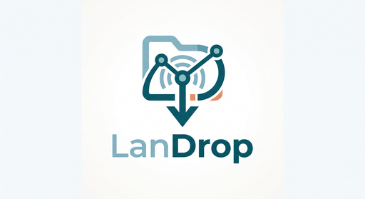

LAN file sharing for your home or office network — no cloud, no accounts, no
internet required. Devices on the same Wi-Fi/LAN discover each other, and you
can send any file with a friendly **Accept / Reject** confirmation on the
receiving side.

- **Rust** backend (tokio + axum) with the web UI embedded inside it
- Devices find each other via **mDNS/DNS-SD** (`_landrop._tcp`), with a manual
  `ip:port` fallback when mDNS is blocked
- Files stream peer-to-peer over plain HTTP on your LAN — nothing leaves your
  network
- **Tauri v2 desktop app** for Linux (optional — the browser UI works too)
- Clean, minimal, Notion-style light UI (no CDNs, no Node build step)

## Features

- Device discovery (mDNS) with 60 s peer expiry + persistent manual peers
- Accept / reject incoming transfers, auto-accept option
- Pick the download folder with a built-in folder browser (no typing paths);
  optional "ask where to save" mode chooses a folder per incoming transfer,
  with a "use default folder" escape hatch
- Live speed and time-remaining estimates while sending or receiving (e.g.
  `31% · 919 KB/s · ~31s left`), a receive-progress notification with a
  progress bar, and an always-visible activity strip so the Receive tab stays
  optional
- Any file type; streaming transfer (no full-file buffering)
- SHA-256 integrity check; the declared size is enforced while streaming;
  collision-safe filenames (`file.txt`, `file-1.txt`, …)
- One-time upload token per transfer, consumed atomically (no accounts, no
  login, no shared secret required — the app is open on your LAN by design)
- Live UI updates over Server-Sent Events (SSE), including throttled progress;
  polling only as a fallback while SSE is unavailable
- Retro-modern UI (cream surfaces, one bold red accent, thick black outlines
  with hard offset shadows, marquee ribbon, dashed upload box, underline
  fields, red pill primary buttons, bottom nav on phones) with a matching dark
  mode — toggle in the top bar, saved per browser; light is the default
- Desktop notifications on incoming requests, and a progress-bar notification
  while receiving (`notify-send` / notification daemon)
- Persistent settings (name, port, download dir) in `~/.config/landrop/config.toml`;
  CLI flags apply to a single run only
- Private, auto-cleaned staging for outgoing files (no leftover copies)
- Tauri desktop wrapper with tray icon (Open / Downloads / Quit), single
  instance, and graceful shutdown
- Works on Linux (primary), Windows and macOS

## Two ways to run

### 1. Browser mode (always works, no extra deps)

```bash
make build              # -> bin/landrop (release)
./bin/landrop           # UI at http://localhost:8420
./bin/landrop --open    # ...and open the browser automatically
./bin/landrop -p 9000   # custom port
./bin/landrop -n living-room   # friendly device name
```

The web UI also works from a phone on the same Wi-Fi:
`http://<your-ip>:8420` (your IPs are shown in the Settings tab, with a
**Copy LAN URL** button).

### 2. Tauri desktop mode (Linux)

Requires the Tauri Linux dependencies (see `docs/DESKTOP_LINUX.md`):

```bash
make desktop-dev        # run in dev mode (cargo tauri dev)
make desktop-build      # build release bundles (deb/rpm/AppImage)
```

The desktop app starts the LanDrop backend inside the process, opens a native
window pointing at the local UI, and adds a tray icon. Closing the window or
choosing **Quit** from the tray shuts the backend down gracefully.

## Build

Requires Rust 1.74+ (tested with 1.92). The browser-mode binary needs no
system dependencies beyond a C toolchain. The UI is embedded — no Node step.

```bash
make build          # -> bin/landrop (release)
make run            # build + run with the UI
make test           # unit + end-to-end tests
make fmt            # cargo fmt
make vet            # cargo clippy -- -D warnings
make icons          # regenerate icon assets (python3 + Pillow)
make clean
```

Or directly:

```bash
cargo run --release
cargo build --release
```

The binary is a single self-contained file at `target/release/landrop`
(`bin/landrop` via `make build`).

### Windows build (browser mode)

```bash
cargo build --release
# run: .\target\release\landrop.exe
# config: %APPDATA%\landrop\config.toml
```

## Install as a Linux desktop app (no sudo)

```bash
make install-desktop
# installs:
#   ~/.local/bin/landrop
#   ~/.local/share/applications/landrop.desktop
#   ~/.local/share/icons/hicolor/256x256/apps/landrop.png
```

Then launch LanDrop from your app menu or run `landrop`.

Remove it:

```bash
make uninstall-desktop
```

## Android app

The same app — same HUD UI, same features — builds for Android from the same
crate (`desktop/`, the Tauri app). Tauri v2 mobile loads it as a library, so the
app logic lives in `desktop/src/lib.rs` and `main.rs` is a thin desktop shim.

```bash
make mobile-targets        # one-time: add the Rust android targets
make mobile-init           # one-time: generate desktop/gen/android (committed)
make mobile-build          # APK for the emulator (x86_64)
make mobile-build-phone    # APK for real phones (aarch64)
make mobile-sign           # sign it locally (debug keystore, for testing)
make mobile-install        # adb install on a connected device/emulator
make mobile-dev            # run with live reload
```

Requirements: Android SDK + platform-tools + NDK (`ANDROID_HOME`, NDK ≥ 28),
JDK 17, and `cargo install tauri-cli --version '^2'`.

Installing on a phone: `make mobile-build-phone`, `make mobile-sign`, then copy
`desktop/gen/android/app/build/outputs/apk/universal/release/app-universal-release.apk`
to the phone and tap it (enable "install unknown apps" for your file manager),
or `make mobile-install` with USB debugging on. The signing target uses a local
**debug** keystore, which is fine for sideloading; a published release would use
your own release keystore (`key.properties`).

What works: discovery (UDP beacon + mDNS), sending, accepting/rejecting, the
folder picker, speed/ETA, SSE live updates, settings, progress in the UI. The
backend runs inside the app process and the webview talks to it on
`127.0.0.1` (cleartext is allowed for localhost only, via
`desktop/gen/android/.../network_security_config.xml`).

Mobile behaviour to know about:

- Received files land in the app's own folder on shared storage:
  `Android/data/dev.landrop.app/files/Download`. No runtime permissions needed,
  reachable over USB and by file managers; the in-app folder picker starts there
  (scoped storage hides most of the rest of the device, so a system-wide folder
  picker would need Android's SAF, which is a follow-up).
- No tray and no system-dialog prompt: the in-app UI shows incoming requests,
  and the activity strip keeps the progress visible from any tab.
- Keep the app open while transferring — Android may suspend background apps.
  A foreground service (background receiving) is on the roadmap, as is
  acquiring the Wi-Fi multicast lock for networks that filter multicast.

## Updating an installed copy

The UI is compiled **into** the binary, so a new build only shows up once the
old process is gone:

1. **Quit the running app first** (tray → **Quit**). A newly launched copy
   otherwise *attaches* to the existing instance (by design) and keeps serving
   the old UI.
2. Rebuild and reinstall:
   - browser mode: `make build` (and `make install-desktop` if installed that way)
   - desktop app: `make desktop-build`, then install the fresh package from
     `target/release/bundle/` (deb/rpm/AppImage)
3. Reload any open browser tab. UI files are served with
   `Cache-Control: no-cache`, so a normal refresh picks up the new assets.

## Run two instances on one machine (test / dev)

```bash
./scripts/run_two_local.sh
```

This builds the app and starts two instances with fully isolated state
(temp config + download dirs, removed when the script exits):

- **A** on port `8420`
- **B** on port `8421`

The script waits until both are serving and registers each instance as the
other's manual peer (mDNS on loopback is unreliable), so you can go straight
to:

1. Open http://localhost:8420 (A), pick a file, select the peer, click **Send**
2. Open http://localhost:8421 (B), click **Accept** — the file lands in B's
   download folder

Both run with `--no-port-scan`, so a busy port fails loudly instead of
silently moving to another one.

## Run on two real machines

1. Install/run LanDrop on both machines (same version recommended).
2. They should appear in each other's device list within seconds — mDNS
   (`_landrop._tcp`) plus a UDP beacon on port 8420 that is re-sent every 2 s,
   so no manual setup is needed on a normal home/office network. If a device
   is missing, check the firewall notes below and see the mDNS
   troubleshooting section (client isolation blocks multicast/broadcast).
3. Pick a file, pick the device, **Send**, then **Accept** on the other side.
4. The file is saved in the download folder (default `~/Downloads/LanDrop`).

If mDNS discovery fails, add a manual peer with the other machine's
`ip:port`, e.g. `192.168.1.25:8420`. Find the IP with `ip addr` (Linux),
`ipconfig` (Windows) or `ifconfig` (macOS).

## Firewall

- **TCP 8420** — the app's listening port (default; change in Settings)
- **UDP 5353** — mDNS discovery (only needed for automatic discovery)

On Linux with firewalld/ufw, allow both. Example (ufw):

```bash
sudo ufw allow 8420/tcp
sudo ufw allow 5353/udp
```

## mDNS troubleshooting

- Some routers/APs block multicast between clients ("client isolation").
  In that case use **manual peers** — the app works fine without mDNS.
- Check that UDP 5353 is allowed and that `avahi-daemon` (or similar) is not
  interfering.
- If discovery works one-way only, both devices must run the same protocol
  version (TXT `ver=1`).

## Security notes

- **LAN only**: the API binds to `0.0.0.0` so devices on your network can
  reach it. Anyone on the same network who knows your port can offer files
  (they still need your **Accept** click) and can open the local UI. This is
  intentional: LanDrop is a no-account, no-login tool for trusted networks.
- **Settings are machine-local**: changing the device name, port, download
  folder, auto-accept or autostart is only accepted from the machine running
  LanDrop. A phone on the LAN can send, accept and reject, but cannot rewrite
  settings.
- **Browser-safe**: cross-origin requests are rejected and `Host` headers must
  be a plain IP/localhost, so a website you happen to visit cannot drive the
  local API (CSRF / DNS rebinding). The bundled UI ships a strict CSP.
- Filenames are sanitized (no path traversal, control characters and bidi
  overrides stripped, length capped), files never overwrite each other, the
  declared size is enforced while streaming, and SHA-256 is verified when the
  sender provides it.
- Outgoing files are staged in a private `outbox` directory under the config
  dir (mode 0700) and deleted once the transfer ends; uploads never buffer a
  whole file in memory.
- Each accepted transfer uses a one-time upload token, consumed atomically on
  first use; no persistent credentials are stored. Link-local, multicast and
  unspecified targets are refused, so the app can't be aimed at metadata
  endpoints or broadcast addresses.
- JSON request bodies are capped at 64 KiB; only the file-upload routes stream
  unbounded data, with free-space guards on both sides.

## Configuration

| Location (Linux) | `~/.config/landrop/config.toml` |
| Location (Windows) | `%APPDATA%\landrop\config.toml` |

```toml
id = "6c1f…"            # auto-generated, stable
name = "laptop"
port = 8420
downloads = "/home/me/Downloads/LanDrop"
auto_accept = false
ask_save_path = false   # ask for a folder when accepting each incoming file
manual_peers = ["192.168.1.25:8420"]
```

> Older configs may contain a `token` key; it is still parsed (for
> backward compatibility) but no longer surfaced in the UI or docs.
>
> `--port`, `--downloads` and `--name` apply to that run only and are **not**
> written to the config file (only the generated identity, an explicitly
> configured `port = 0`, settings saved in the UI, and manual peers are
> persisted). `LANDROP_CONFIG_DIR` is still honored when set before launch.

## Project layout

```
landrop/
  PLAN.md
  Cargo.toml            # workspace root (members: desktop)
  Makefile
  README.md
  assets/
    icon.svg            # app icon (SVG)
    icon.png            # 256x256 mark (launcher/app icon)
    icon-32.png/.rgba   # tray icon for the desktop wrapper
    icon-soft.png       # 128x128 mark on UI grey (header logo)
    icon-with-name.png  # full logo with name (docs/README)
    landrop.desktop     # Linux desktop entry
  src/
    main.rs             CLI: flags, signal handling, uses landrop::app
    app.rs              reusable startup (NodeOptions / start_node / RunningNode)
    lib.rs
    config.rs           TOML config (0600)
    protocol.rs         wire types + sanitize/unique-path/sha helpers
    peers.rs            peer store (mdns + manual, TTL expiry)
    discovery.rs        mDNS advertise + browse (_landrop._tcp)
    events.rs           SSE event bus
    notify.rs           desktop notifications (best-effort)
    util.rs             shared helpers (detached processes, disk space)
    transfer.rs         transfer state machine + manager
    transfer/sender.rs  outgoing: offer -> poll -> stream upload
    transfer/receiver.rs incoming: temp file -> verify -> rename
    server.rs           axum router + app state
    server/handlers.rs  local API + wire protocol + SSE + UI
  desktop/
    Cargo.toml          Tauri v2 wrapper crate (landrop-desktop)
    tauri.conf.json
    src/main.rs         window, tray, single-instance, graceful shutdown
  ui/
    index.html          single-page UI (tabs: Send / Receive / Settings)
    styles.css          Notion-style light theme
    app.js              vanilla JS, SSE + fetch, debounced renders
  tests/
    integration.rs      in-process e2e (offer/accept/reject/upload) + start_node
  scripts/
    run_two_local.sh
    generate_icons.py    # regenerate icon assets from logo_now/ sources
  logo_now/
    landrop_transparent.png  # logo source: mark only
    landrop_with_name.png    # logo source: mark + name
  docs/
    DESKTOP_LINUX.md    Tauri deps, build and troubleshooting
```

## API (local)

| Endpoint | Purpose |
| --- | --- |
| `GET /api/info` | device id, name, port, download dir, version, LAN IPs, free/total disk space |
| `GET /api/peers` | discovered + manual peers |
| `POST /api/peers/manual` | add a manual peer (`{"address":"ip:port"}`) |
| `GET /api/transfers` | all transfers |
| `POST /api/send` | start a send (multipart: `target`, `file`) |
| `POST /api/transfers/{id}/cancel` | cancel |
| `POST /api/transfers/{id}/accept` | accept incoming (optional `{"save_dir": "/path"}`) |
| `POST /api/transfers/{id}/reject` | reject incoming |
| `GET /api/fs/list?path=…` | browse subfolders (folder picker) |
| `POST /api/fs/mkdir` | create a folder from the picker |
| `GET /api/events` | SSE stream (`peer_updated`, `transfer_updated`, …) |
| `GET/POST /api/settings` | read / update settings |

## Wire protocol (device ↔ device)

```
POST /api/v1/offer                    {sender_id, sender_name, filename, size, sha256?, note?}
GET  /api/v1/offer/{id}               {status: pending|accepted|rejected, upload_url?, upload_token?}
POST /api/v1/upload/{id}              body: raw file bytes, header X-LanDrop-Upload-Token
```

Offers time out after 120 s. The one-time upload token is generated on
accept and never persisted.

## Screenshots

Retro-modern theme (default), light and dark — same UI in the browser, the
desktop app and the Android app:

| Send (light) | Send (dark) | Receive | Settings |
| --- | --- | --- | --- |
| 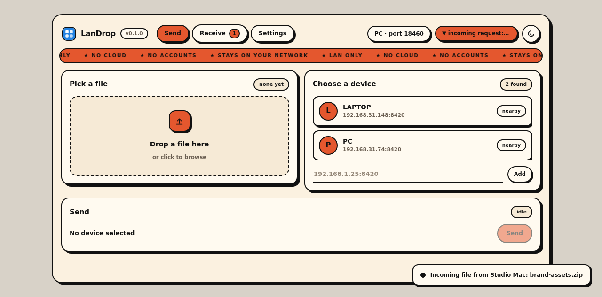 | 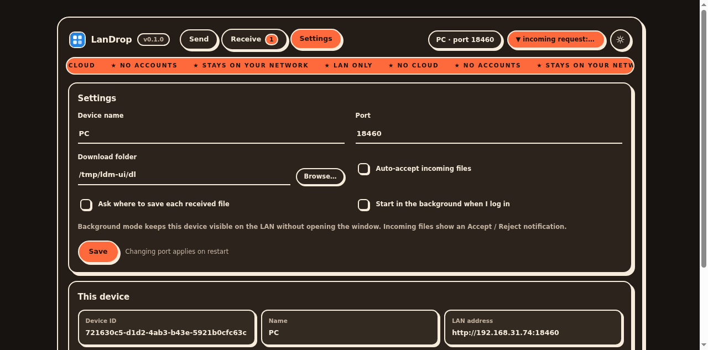 | 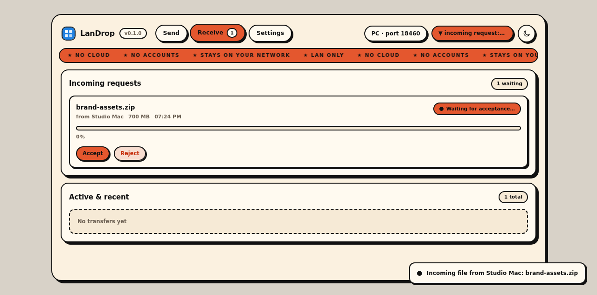 | 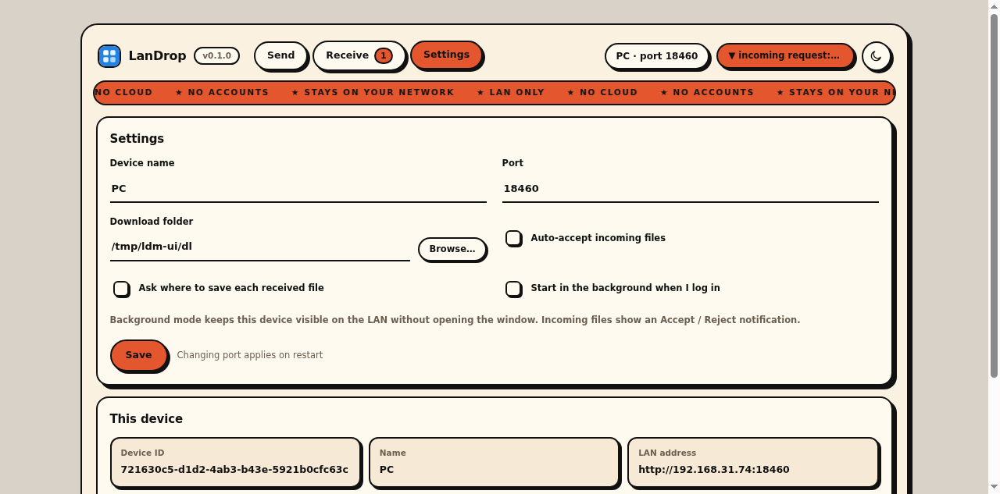 |

Phone layout (the tabs become a fixed bottom nav, the way the reference does it):

| Send, phone |
| --- |
|  |

Older monochrome HUD screenshots (previous design, kept for reference):

| Send | Receive | Settings |
| --- | --- | --- |
| 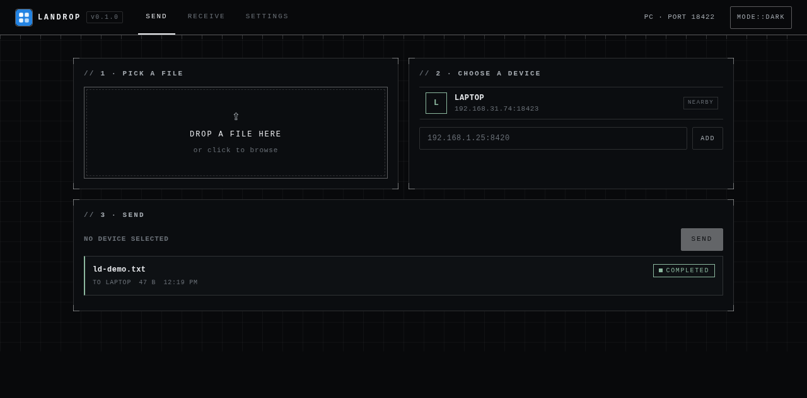 | 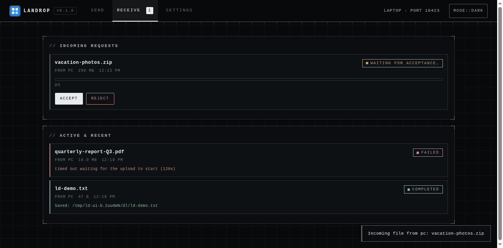 | 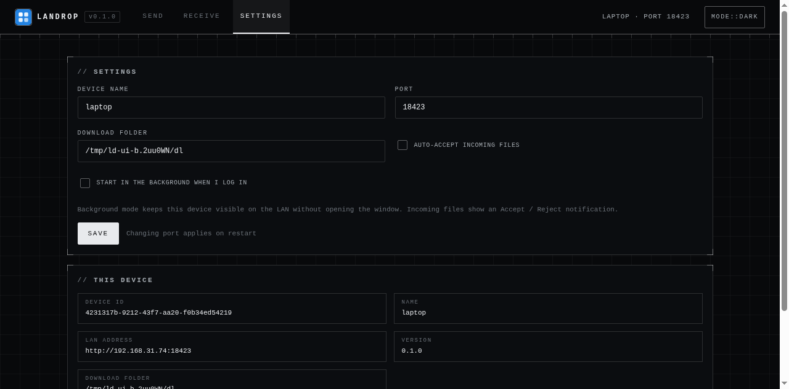 |

Android app (same UI, same features):

| Send | Receive (waiting) | Folder picker |
| --- | --- | --- |
| 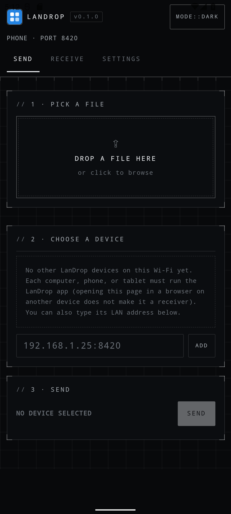 | 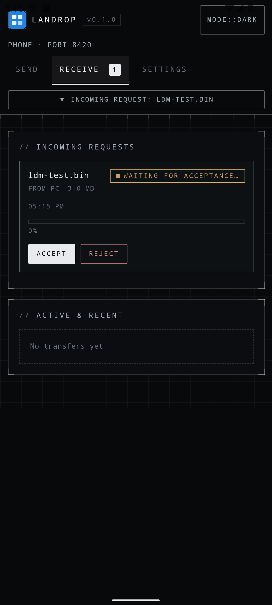 | 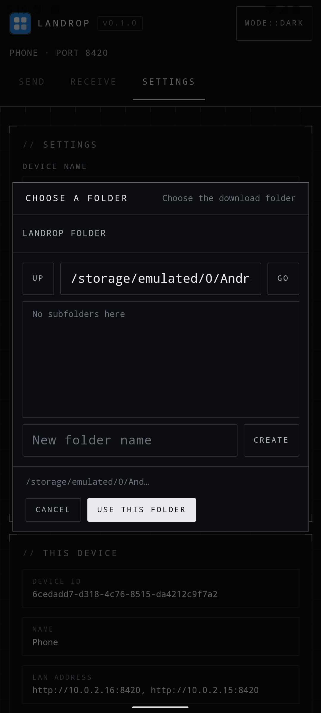 |

## Known limitations

- No pause/resume; an interrupted transfer must be re-sent.
- A transfer with no progress for 10 minutes is failed automatically.
- Transfer history is in-memory only (lost on restart; terminal entries are
  dropped after an hour).
- Settings and "open download folder" are only available from the machine
  running LanDrop (sending, accepting and rejecting work from any LAN device).
- Choosing a per-transfer save folder (and the folder browser) is likewise
  machine-local; accepts from other devices use the configured folder.
- mDNS on some networks (client isolation, VPNs) is unreliable — manual peers
  cover this.
- One file per transfer from the UI (the backend protocol supports any size).
- The Tauri wrapper is Linux-first (works on Windows/macOS with the standard
  Tauri deps, but is only tested on Linux).

## Roadmap / next steps

- QR code of `http://<ip>:<port>` for phone onboarding
- Transfer history persisted to disk (JSON/SQLite)
- Speed estimate + ETA in the UI
- Multiple-file and folder drag & drop
- systemd user unit
